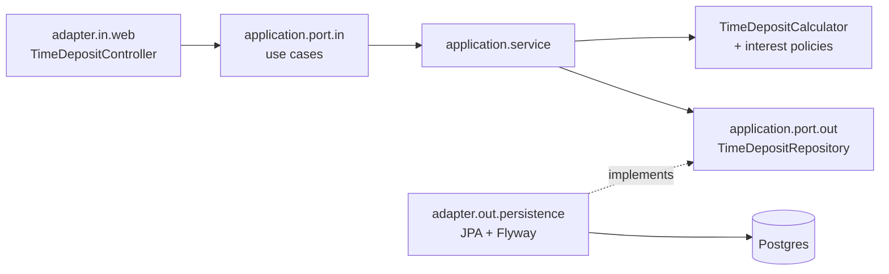

# Time Deposit API (Java)

Spring Boot 3.5 service with a hexagonal layout and two endpoints.
The task text is in the root `README.md`. Assumptions are in the root `ASSUMPTIONS.md`.

## Requirements

- JDK 17 (`sdk use java 17.0.0-tem`)
- Docker (Testcontainers starts Postgres for tests and for the local run)

## Run the app

```sh
cd java
mvn spring-boot:test-run
```

This starts Postgres in Docker, applies the Flyway migrations (schema and demo data), and serves the app on port 8080.
To use your own Postgres instead, set `DB_URL`, `DB_USER`, `DB_PASSWORD` and run `mvn spring-boot:run`.

## Trigger the endpoints with Swagger

1. Open http://localhost:8080/docs
2. `GET /time-deposits`: click **Try it out**, then **Execute**. Returns every deposit with `id`, `planType`, `balance`, `days`, `withdrawals`.
3. `POST /time-deposits/balance-updates`: click **Try it out**, then **Execute**. Applies one month of interest to every deposit. Returns `204`.
4. Run the GET again to see the new balances.

The OpenAPI contract is at http://localhost:8080/v3/api-docs (JSON) and http://localhost:8080/v3/api-docs.yaml.

Same calls with curl:

```sh
curl http://localhost:8080/time-deposits
curl -X POST http://localhost:8080/time-deposits/balance-updates
```

## Demo data

| id | plan | days | balance | after one POST |
|----|------|------|---------|----------------|
| 1 | basic | 30 | 1000.00 | 1000.00 |
| 2 | basic | 31 | 1000.00 | 1000.83 |
| 3 | student | 365 | 1000.00 | 1002.50 |
| 4 | student | 366 | 1000.00 | 1000.00 |
| 5 | premium | 45 | 1000.00 | 1000.00 |
| 6 | premium | 46 | 1000.00 | 1004.17 |
| 7 | basic | 45 | 1234567.00 | 1235595.81 |

Each POST adds one more month. Restart the app to reset the data.

## Tests

```sh
mvn test     # unit, web slice and architecture tests, no Docker
mvn verify   # adds the Testcontainers integration tests
mvn org.pitest:pitest-maven:mutationCoverage   # mutation tests on the core
```

On Colima, point Testcontainers at the Colima socket first:

```sh
export DOCKER_HOST=unix://$HOME/.colima/default/docker.sock
export TESTCONTAINERS_DOCKER_SOCKET_OVERRIDE=/var/run/docker.sock
```

## Layout



`ArchitectureTest` fails the build if `domain`, `interest` or `application` import Spring, JPA or an adapter.
