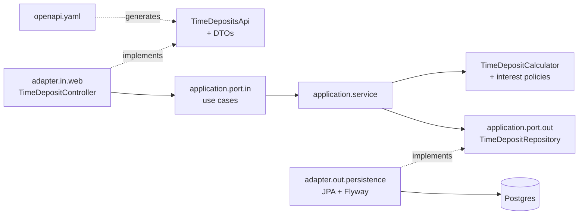
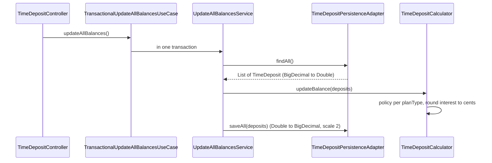

# Time Deposit API (Java)

Spring Boot 3.5 service with a hexagonal layout and exactly two endpoints.
The task text is in the root `README.md`, left as it was.
Assumptions are in the root `ASSUMPTIONS.md`. AI use is in the root `AI_USAGE.md`.

## Requirements

- JDK 17 (`sdk use java 17.0.0-tem`)
- Docker (Testcontainers starts Postgres for the tests and for the local run)
- Maven

## Run the app

```sh
cd java
mvn spring-boot:test-run
```

This starts Postgres in Docker, applies the Flyway migrations (schema and demo data), and serves the app on port 8080.
It uses `TestTimeDepositApplication`, the Spring Boot way to start services with Testcontainers at development time.

To use your own Postgres instead, set `DB_URL`, `DB_USER`, `DB_PASSWORD` and run `mvn spring-boot:run`.
Without a running Postgres, `mvn spring-boot:run` stops with `Connection to localhost:5432 refused`.

On Colima, point Testcontainers at the Colima socket first:

```sh
export DOCKER_HOST=unix://$HOME/.colima/default/docker.sock
export TESTCONTAINERS_DOCKER_SOCKET_OVERRIDE=/var/run/docker.sock
```

## Swagger walkthrough

Open http://localhost:8080/docs. It redirects to Swagger UI, which shows the hand written contract `openapi.yaml`.
The page lists two operations under `time-deposits`.

### 1. `GET /time-deposits`

1. Click **GET /time-deposits**, then **Try it out**, then **Execute**.
2. The response is `200` with every deposit, ordered by `id`.
   Each has `id`, `planType`, `balance`, `days`, `withdrawals`.
   Each withdrawal has `id`, `amount`, `date`.

First rows of the demo data:

```json
[
  {"id": 1, "planType": "basic", "balance": 1000.00, "days": 30, "withdrawals": []},
  {"id": 2, "planType": "basic", "balance": 1000.00, "days": 31, "withdrawals": [
    {"id": 1, "amount": 100.00, "date": "2026-09-15"},
    {"id": 2, "amount": 50.25, "date": "2026-10-01"}]}
]
```

### 2. `POST /time-deposits/balance-updates`

1. Click **POST /time-deposits/balance-updates**, then **Try it out**, then **Execute**.
2. The response is `204` with no body. Every deposit got one month of interest.
3. Run the GET again to see the new balances (table below).

Each POST adds one more month, so it is not idempotent. Restart the app to reset the data.
In production a month must be paid once. The planned fix is in `ASSUMPTIONS.md`, section "Idempotency".

Same calls with curl:

```sh
curl http://localhost:8080/time-deposits
curl -X POST http://localhost:8080/time-deposits/balance-updates
```

### Demo data

One deposit per rule boundary, plus the README test data (id 7). Loaded by `V2__demo_seed_data.sql`.

| id | plan | days | balance | after one POST | why |
|----|------|------|---------|----------------|-----|
| 1 | basic | 30 | 1000.00 | 1000.00 | day 30, still in the first 30 days |
| 2 | basic | 31 | 1000.00 | 1000.83 | `1000.00 * 0.01 / 12 = 0.8333` gives `+0.83` |
| 3 | student | 365 | 1000.00 | 1002.50 | `1000.00 * 0.03 / 12 = 2.50` |
| 4 | student | 366 | 1000.00 | 1000.00 | past one year, no interest |
| 5 | premium | 45 | 1000.00 | 1000.00 | premium starts after day 45 |
| 6 | premium | 46 | 1000.00 | 1004.17 | `1000.00 * 0.05 / 12 = 4.1666` gives `+4.17` |
| 7 | basic | 45 | 1234567.00 | 1235595.81 | `1028.8058` gives `+1028.81` |

## Architecture

Hexagonal layout under `org.ikigaidigital`.



| Package | Holds |
|---------|-------|
| `org.ikigaidigital` | the frozen `TimeDeposit` and `TimeDepositCalculator` |
| `interest` | `InterestPolicy` and one policy per plan: `BasicInterestPolicy`, `StudentInterestPolicy`, `PremiumInterestPolicy` |
| `domain` | `TimeDepositDetails` and `Withdrawal`, the read model for the GET |
| `application.port.in` | `UpdateAllBalancesUseCase`, `GetAllTimeDepositsUseCase` |
| `application.port.out` | `TimeDepositRepository` |
| `application.service` | `UpdateAllBalancesService`, `GetAllTimeDepositsService` |
| `adapter.in.web` | `TimeDepositController`, `TimeDepositWebMapper` |
| `adapter.out.persistence` | JPA entities, `TimeDepositJpaRepository`, `TimeDepositPersistenceAdapter`, `TimeDepositMapper` |
| `config` | `UseCaseConfig` and `TransactionalUpdateAllBalancesUseCase` |
| `app` | `TimeDepositApplication`, the startup class |

Flow of one POST:



`ArchitectureTest` fails the build if the core (root package, `domain`, `interest`, `application`)
imports Spring, JPA, Hibernate, an adapter or `config`,
or if `adapter.in.web` reaches past the use case ports.

### Contract first

The contract is the hand written `src/main/resources/openapi.yaml`. It has exactly the two operations.

- `mvn compile` runs `openapi-generator-maven-plugin`. It writes the `TimeDepositsApi` interface and the
  `TimeDepositDto` and `WithdrawalDto` classes to `target/generated-sources/openapi`. Nothing generated is committed.
- `TimeDepositController` implements `TimeDepositsApi` and only calls the use case ports.
- Swagger UI shows that same file, served at http://localhost:8080/openapi.yaml.
- To change the API, edit `openapi.yaml` first. The build then fails until the controller matches.

http://localhost:8080/v3/api-docs is the spec springdoc builds from the running code.
It stays on because springdoc 2.9.1 turns Swagger UI off with it.
`TimeDepositApiIT` checks that both specs list only the two endpoints.

## Analysis

The full read only analysis is in `docs/ai/analysis.md`. The traps it found in the original code:

1. Boundaries: `getDays() > 30` for all plans, `> 45` for premium, `< 366` for student.
2. `new BigDecimal(double)` takes the exact binary value. `BigDecimal.valueOf(double)` can round differently.
3. Money is a `Double`, and all math is `double`.
4. An unknown plan, or a wrong case like `Basic`, gets zero interest and no error.
5. `TimeDeposit` has no withdrawals, but the GET must return them.
6. The only test was `assertThat(1).isEqualTo(1);`, so green meant nothing.

## Decisions

- Tests first. `TimeDepositCalculatorTest` pins today's results in one `@CsvSource` table, 32 tests,
  before any refactor. Expected values are the real output on JDK 17, checked with exact `double` equality.
- Mutation testing proves the tests catch changes. PIT kills every mutant it makes.
  A scratch script covers mutants PIT cannot make, such as other rounding modes and `BigDecimal.valueOf`.
- One `InterestPolicy` per plan, looked up by plan name in a `Map`. A new plan is one new class and one map entry.
  The 30 day rule stays in the calculator, because it applies to every plan.
- `TimeDeposit` is untouched. The GET uses a separate read model, `TimeDepositDetails`, that carries the withdrawals.
- Postgres with Flyway. Table and column names match the README exactly, quoted so Postgres keeps the camelCase.
- `DECIMAL(19,2)` in the database, `Double` in `TimeDeposit`. `TimeDepositMapper` converts at the edge.
- Withdrawals load in one query, no N+1. `TimeDepositPersistenceAdapterIT` checks one prepared statement.
- The update runs in one transaction, opened by a decorator in `config`, so `application` stays Spring free.
- Swagger UI moved to `/docs`. The API paths have no `/api` prefix.

## Trade-offs

- Pessimistic row locks, not optimistic. A second POST at the same moment waits instead of failing.
  It then reads the new balances, so no month is lost. `ASSUMPTIONS.md` #11 has both options.
- `/v3/api-docs` stays on next to the hand written spec, because of the springdoc 2.9.1 limit above. A test keeps both in step.
- The local run uses the Testcontainers dev runner, not a `docker-compose.yml`. Spring Boot documents both. The runner needs no extra file.
- JaCoCo line coverage is not 100%: `TimeDepositApplication.main` is not run by a test.
  A test there would boot a second full app only to move the number.
- `days` never moves. The calculator does not change it, and the README does not say what should.

## With more time

Each item comes from the analysis or the assumptions.

- Decide with the business what advances `days`, and who calls the update each month (analysis §5, items 5 and 6).
- Page the deposits behind the same `TimeDepositRepository` port, instead of loading all of them (analysis §5, item 19).
- Money as `BigDecimal` end to end. Today the frozen `TimeDeposit` and calculator keep it in `double` (analysis §4, items 1 to 3).

## Tests

```sh
mvn test     # unit, web slice and architecture tests, no Docker
mvn verify   # adds the Testcontainers integration tests
mvn org.pitest:pitest-maven:mutationCoverage   # mutation tests on the core
```

Last `mvn clean verify`: 44 unit tests and 11 integration tests, all green.

| Test class | Tests | Checks |
|------------|-------|--------|
| `TimeDepositCalculatorTest` | 32 | every plan and boundary, to the cent |
| `ArchitectureTest` | 3 | hexagonal rules |
| `TimeDepositMapperTest` | 3 | `BigDecimal` and `Double` conversion, float noise dropped |
| `TimeDepositControllerTest` | 2 | web slice for both endpoints |
| `TransactionalUpdateAllBalancesUseCaseTest` | 2 | one committed transaction, rollback on failure |
| `UpdateAllBalancesServiceTest` | 1 | use case with an in memory repository, no mocks |
| `GetAllTimeDepositsServiceTest` | 1 | use case with an in memory repository, no mocks |
| `TimeDepositApiIT` | 6 | end to end: exact GET body, POST results, exactly two endpoints, Swagger at `/docs` |
| `TimeDepositPersistenceAdapterIT` | 3 | Postgres in Testcontainers, one statement for all withdrawals, rounded balances |
| `DemoSeedDataIT` | 1 | Flyway loads one deposit per boundary with withdrawals |
| `ConcurrentBalanceUpdateIT` | 1 | 8 updates at once each apply one month, none lost |
